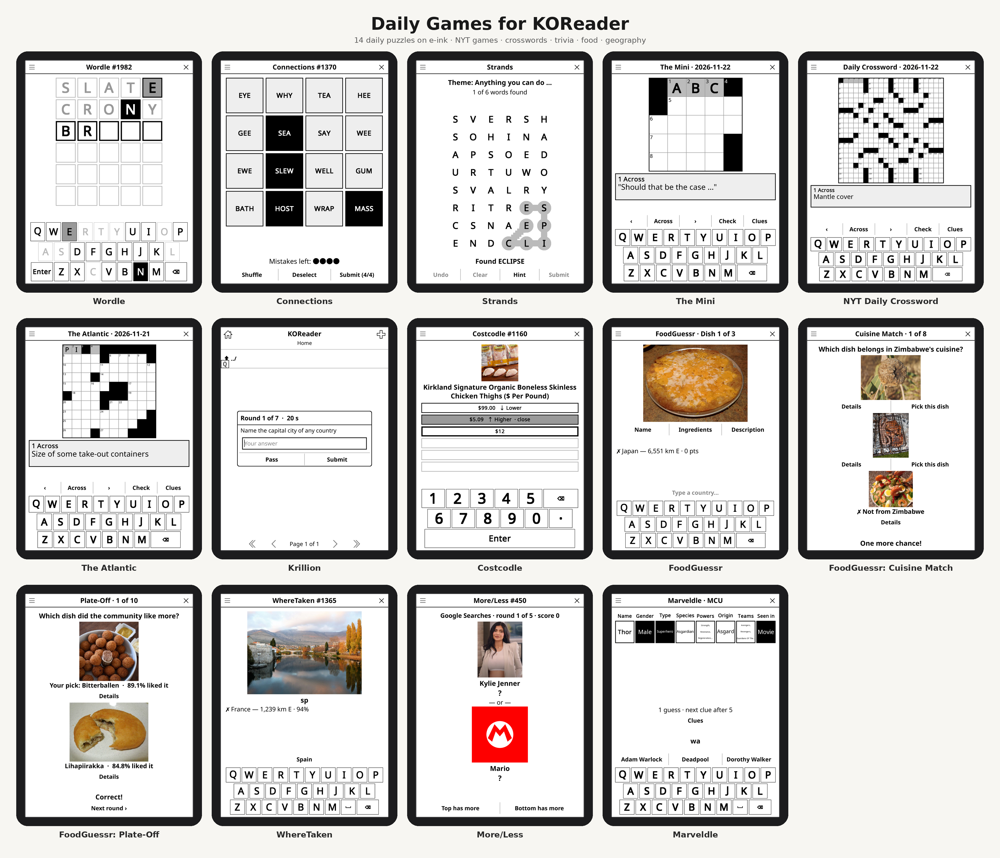

# Daily Games for KOReader

Fourteen daily puzzles on your e-reader, designed for black-and-white e-ink: NYT Wordle, Connections, Strands and crosswords, plus trivia, food, geography and more. Works on any KOReader device, and integrates with the ZenOS launcher on jailbroken Kindles.



## Install

**ZenPM (recommended).** Open ZenPM > **Sources**, add this URL, refresh, then install **Daily Games** from Games. ZenPM offers updates for new releases.

```
https://helloparthshah.github.io/dailygames.koplugin/
```

From a terminal: `zenpm repo add dailygames https://helloparthshah.github.io/dailygames.koplugin/ && zenpm repo refresh && zenpm install dailygames`

**Manual.** Download `dailygames.koplugin.zip` from [Releases](https://github.com/helloparthshah/dailygames.koplugin/releases), unzip it, and copy the `dailygames.koplugin` folder into `koreader/plugins/` (with ZenFM or over USB). Restart KOReader.

Needs Wi-Fi to fetch each day's puzzles. Progress is saved on the device, so you can leave a game and come back.

## Open

- **ZenOS App Launcher:** "Daily Games" is added automatically. The hub shows ✓ for games you've finished today and … for ones you've started.
- **KOReader menu:** Tools > Daily Games.
- **Gestures:** bind **Daily Games hub** or **Daily Games: \<game\>** (General section).

Every game has a ☰ menu with **How to play** and **Restart puzzle**.

**Endless modes** (hub > Endless modes, or Tools > Daily Games > Endless modes) let you keep playing after today's puzzle, using what each site offers for free:

- **Wordle:** a random past NYT Wordle.
- **FoodGuessr:** the site's Quick Play, five random dishes.
- **Costcodle:** a random item from earlier days.
- **Cuisine Match:** FoodGuessr's own random game.
- **The Atlantic:** a random puzzle from the last two weeks.

Endless games are saved separately, so they never touch today's puzzle or its ✓. Tap **Next puzzle ›** when you finish one, or ☰ > **New puzzle** to skip.

## Games

| Game | Source | What you do |
| --- | --- | --- |
| Wordle | NYT | Guess the five-letter word in six tries. |
| Connections | NYT | Sort 16 words into four groups. |
| Strands | NYT | Find the theme words and the spangram in a letter grid. |
| The Mini | NYT | 5×5 crossword. |
| Daily Crossword | NYT | The full daily crossword (see note below). |
| The Atlantic | The Atlantic | The Atlantic's free daily crossword. |
| Krillion | krillion.io | Seven trivia prompts; rarer answers score more. |
| Costcodle | costcodle.com | Guess the price of a Costco item. |
| FoodGuessr | foodguessr.com | Three dishes; guess each one's country. |
| Cuisine Match | foodguessr.com | Which of three dishes belongs to a country's cuisine? |
| Plate-Off | foodguessr.com | Which of two dishes did players like more? |
| WhereTaken | wheretaken.teuteuf.fr | Where was the photo taken? Plus landmark, capital and city bonus rounds. |
| More/Less | lessgames.com | Which of two things has more searches, streams, rating or price? |
| Marveldle | marveldle.com | Guess the MCU character from attribute clues. |

On e-ink, colours become shades: black means right, gray means partly right, and white or faded means wrong. Each game's **How to play** explains its marks.

**NYT Daily Crossword:** the full crossword is subscriber content. If it doesn't load, set your `NYT-S` cookie under Tools > Daily Games. The Mini works without it.

## Disclaimer

This is an unofficial fan project. It is not affiliated with or endorsed by The New York Times, The Atlantic, Amuse Labs, Krillion, Costcodle, FoodGuessr, Teuteuf Games, Less Games or Marveldle. All puzzles, images and game data belong to their owners and are fetched from their public sites each day; nothing is bundled with the plugin. Krillion, More/Less and Marveldle answers are checked by their sites' servers, as in their web games. Please support the original games.

## Feedback

Ideas for other daily games, or problems on your device? [Open an issue](https://github.com/helloparthshah/dailygames.koplugin/issues). For crashes, attaching the end of `koreader/crash.log` helps a lot.

## Development

Built with [Claude Code](https://claude.com/claude-code).

```
main.lua                    menu, hub, dispatcher actions
dailygames/ui.lua           e-ink UI: full-screen base, drawn boards, keyboard, photos
dailygames/http.lua         JSON over HTTPS
dailygames/store.lua        settings and per-day progress (settings/dailygames.lua)
dailygames/<game>.lua       one file per game (nyt.lua and amuse.lua fetch crosswords)
dailygames/zenos.lua        ZenOS App Launcher entry
```

To add a game, create `dailygames/<game>.lua` with a `launch()` function (subclass `UI.FullscreenApp` for a full-screen board) and add it to `GAMES` in `main.lua`.

Tests run against stubbed KOReader modules:

```sh
for t in tests/test_*.lua; do luajit tests/run.lua "$t"; done
```

The **Emulator screenshots** workflow runs every game in the real KOReader desktop build. To release, run the **Release** workflow with a version: it runs the tests, attaches `dailygames.koplugin.zip`, and updates the ZenPM source (published to GitHub Pages).
